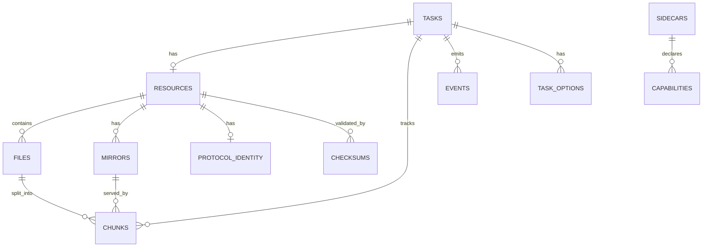

# 06 数据模型与存储设计

> 文档编号：UD-DOC-06 ｜ 版本：v0.7 ｜ 状态：草案（DDL v1 已落地；写事务有界 BUSY 重放已落地；**§7 保留/刷盘/元数据聚合策略 2026-11-18 全部落地**；**§6 凭据 OS 钥匙串后端 2026-11-17 已落地，macOS / Windows / Linux 三平台真机路径均已于 2026-11-19 前验证**） ｜ 日期：2026-11-19 ｜ 上游：`05` ｜ 相关：ADR-0013、ADR-0015、ADR-0020

> **v0.7 变更 / 2026-11-19 时点口径（Linux `secret-tool` 真机验证补齐；下文各版说明为更早时点值，保留不改）**：
> 实验室主机 A（Ubuntu 23.04 / x86_64，其 `ens192` 地址为 `192.168.1.222`）安装
> `libsecret-tools` 与 `gnome-keyring`，在 `dbus-run-session` 中解锁真实 GNOME Keyring 后，
> 以真实 `/usr/bin/secret-tool` 跑 `internal/security/keychain_linux_real_test.go` 五条真机用例
> 全部 PASS：后端选择、含多字节 UTF-8 的往返、独立 `secret-tool lookup` 验证条目确实进入 OS
> 钥匙串（Delete 后消失）、缺失/异 scheme 引用的 not-found 与幂等删除、两个 id 的隔离、
> 密钥只走 stdin。证据 `docs/evidence/linux-keychain-2026-11-19/keychain_linux_real_machine.txt`。
> 该测试带 `linux && keyringreal` 构建标签，不进 CI；CI 仍由假 helper 验证本项目自身的
> argv / stdin / 退出码处理。

> **v0.3 实现校准**（2026-11-13，不改 DDL / 字段）：CI 在 `make gates-strict` 的
> `cover` 步骤偶发 `SQLITE_BUSY`（WAL 的 `SQLITE_BUSY_SNAPSHOT` 不调用 busy handler，
> `busy_timeout` 对其无效）。§5 / §7 补记 `internal/store.withTx` 的**有界重放**实现：
> 单写锁 + 最多 6 次重放 + 5ms 递增退避，仅对 `SQLITE_BUSY` / `SQLITE_LOCKED`
> 文本命中，每次重放前事务回滚、回调无 DB 外副作用；永久锁库仍 fail loud。
> DDL、11 张表与 `app_meta.schema_version = 1` 均未变，§10 增加 4 条回归用例追踪。
>
> **v0.2 实现校准**：DDL v1 的 11 张表已在 `internal/store/migrations/001_init.sql` 全量落地，`app_meta.schema_version = 1`。补充 §6 的「请求头落库」规则与 §10 的位图编码规范（此前未定义字节数，导致实现与测试口径不一致）。P0 凭据存储为进程内参考实现，OS 钥匙串适配器仍属 P1，见 [ADR-0020](adr/ADR-0020-P0实现基线与范围声明.md)。

## 1. 存储选型

| 项 | 选择 | 理由 |
|---|---|---|
| 主存储 | SQLite（`modernc.org/sqlite`，纯 Go，无 cgo） | 事务、WAL、单文件、移动端可用、保持 `CGO_ENABLED=0` |
| 凭据 | 系统钥匙串（Keychain / Credential Manager / libsecret） | 不入库、不进日志；DB 只存 `credential_ref` |
| 二进制内容 | 文件系统 `.part` + 原子 rename | 不把大文件塞进 DB |
| 会话/积分 | 文件（Telegram session、eD2k RSA PEM 0600、`clients.met`） | 与库的事务边界无关，单独备份 |

## 2. ER 图



## 3. 表结构（DDL 基线 v1）

```sql
PRAGMA journal_mode = WAL;
PRAGMA foreign_keys = ON;
PRAGMA busy_timeout = 5000;

CREATE TABLE app_meta (
    key TEXT PRIMARY KEY,
    value TEXT NOT NULL
); -- schema_version, created_at, build_id

CREATE TABLE tasks (
    id            TEXT PRIMARY KEY,          -- ULID
    state         TEXT NOT NULL,             -- 见 05 §4 状态机
    input         TEXT NOT NULL,             -- 原始输入（脱敏后）
    input_kind    TEXT NOT NULL,             -- url|magnet|torrent|metalink|thunder|site|telegram|ed2k
    resource_id   TEXT,
    priority      INTEGER NOT NULL DEFAULT 0,
    error_kind    TEXT,
    error_message TEXT,
    bytes_done    INTEGER NOT NULL DEFAULT 0,
    bytes_total   INTEGER NOT NULL DEFAULT 0,
    bytes_uploaded INTEGER NOT NULL DEFAULT 0,  -- announce 统计唯一取数源
    created_at    INTEGER NOT NULL,
    updated_at    INTEGER NOT NULL,
    completed_at  INTEGER
);
CREATE INDEX idx_tasks_state_priority ON tasks(state, priority DESC, created_at);

CREATE TABLE resources (
    id         TEXT PRIMARY KEY,
    task_id    TEXT NOT NULL REFERENCES tasks(id) ON DELETE CASCADE,
    kind       TEXT NOT NULL,                -- single|multi|stream|torrent|ed2k
                                              -- 2026-11-19: "stream" 由 hls Resolver（ADR-0023）首次落地，Identity.IsAdaptive / VariantID 随之启用（选流在传输层，VariantID 暂空）
    engine     TEXT NOT NULL DEFAULT 'go',  -- go|byo_adapter（任务级路由）
    options    TEXT NOT NULL DEFAULT '{}',  -- JSON: limits/post_process
    headers    TEXT NOT NULL DEFAULT '{}',  -- 按任务隔离，值已脱敏检查
    cred_ref   TEXT                        -- 钥匙串引用，禁止明文
);

CREATE TABLE files (
    id         INTEGER PRIMARY KEY AUTOINCREMENT,
    resource_id TEXT NOT NULL REFERENCES resources(id) ON DELETE CASCADE,
    idx        INTEGER NOT NULL,
    rel_path   TEXT NOT NULL,               -- 经 PathGuard 校验，禁止 .. / 绝对路径
    size       INTEGER NOT NULL DEFAULT 0,
    selected   INTEGER NOT NULL DEFAULT 1,
    final_path TEXT,
    UNIQUE(resource_id, idx)
);

CREATE TABLE mirrors (
    id          INTEGER PRIMARY KEY AUTOINCREMENT,
    resource_id TEXT NOT NULL REFERENCES resources(id) ON DELETE CASCADE,
    url         TEXT NOT NULL,              -- 已过 SSRF Guard（含重定向终态）
    priority    INTEGER NOT NULL DEFAULT 0,
    geo         TEXT,
    weight      REAL NOT NULL DEFAULT 1.0, -- 失败率动态调整
    failures    INTEGER NOT NULL DEFAULT 0
);

CREATE TABLE protocol_identity (
    resource_id   TEXT PRIMARY KEY REFERENCES resources(id) ON DELETE CASCADE,
    infohash_v1   TEXT,
    btmh_v2       TEXT,
    private_flag  INTEGER NOT NULL DEFAULT 0,
    trackers_json TEXT,                    -- [[tier1...],[tier2...]]
    passkey_ref   TEXT,                    -- 引用；明文绝不落库
    peer_id       TEXT,
    ed2k_hash     TEXT,
    aich_root     TEXT,
    user_hash     TEXT,
    ident_key_ref TEXT,
    credits_ref   TEXT,
    variant_id    TEXT,
    is_adaptive   INTEGER NOT NULL DEFAULT 0
);

CREATE TABLE checksums (
    id          INTEGER PRIMARY KEY AUTOINCREMENT,
    resource_id TEXT NOT NULL REFERENCES resources(id) ON DELETE CASCADE,
    file_idx    INTEGER NOT NULL DEFAULT 0,
    algo        TEXT NOT NULL,             -- sha256|sha1|md5|piece-sha1
    scope       TEXT NOT NULL,             -- whole|piece
    chunk_index INTEGER,
    value       TEXT NOT NULL
);
CREATE INDEX idx_checksums_lookup ON checksums(resource_id, scope, chunk_index);

CREATE TABLE chunks (
    id           INTEGER PRIMARY KEY AUTOINCREMENT,
    task_id      TEXT NOT NULL REFERENCES tasks(id) ON DELETE CASCADE,
    file_idx     INTEGER NOT NULL DEFAULT 0,
    idx          INTEGER NOT NULL,          -- 分片序号 / BT piece index
    start        INTEGER NOT NULL,
    length       INTEGER NOT NULL,
    state        TEXT NOT NULL,             -- pending|assigned|done|verified|failed
    attempt      INTEGER NOT NULL DEFAULT 0,
    mirror_id    INTEGER,
    hash_ok      INTEGER NOT NULL DEFAULT 0,
    updated_at   INTEGER NOT NULL,
    UNIQUE(task_id, file_idx, idx)
);
CREATE INDEX idx_chunks_pending ON chunks(task_id, state);

CREATE TABLE task_options (
    task_id TEXT NOT NULL REFERENCES tasks(id) ON DELETE CASCADE,
    key     TEXT NOT NULL,
    value   TEXT NOT NULL,
    PRIMARY KEY(task_id, key)
);

CREATE TABLE events (
    id      INTEGER PRIMARY KEY AUTOINCREMENT,
    task_id TEXT,
    type    TEXT NOT NULL,
    payload TEXT NOT NULL,
    ts      INTEGER NOT NULL
);
CREATE INDEX idx_events_ts ON events(ts);

CREATE TABLE sidecars (
    name         TEXT PRIMARY KEY,
    version      TEXT,
    min_version  TEXT,
    license      TEXT,
    sha256       TEXT,
    source_url   TEXT,
    buildconf    TEXT,
    status       TEXT NOT NULL DEFAULT 'absent', -- absent|ready|degraded|failed
    capabilities TEXT NOT NULL DEFAULT '[]'
);
```

## 4. `Resource` JSON 示例

### 4.1 单文件 HTTP（含多镜像 + 分块校验）
```json
{
  "id": "01J...", "kind": "single", "engine": "go",
  "files": [{ "index": 0, "path": "ubuntu.iso", "size": 2147483648, "selected": true }],
  "mirrors": [
    { "url": "https://mirror.a/ubuntu.iso", "priority": 1 },
    { "url": "https://mirror.b/ubuntu.iso", "priority": 2 }
  ],
  "checksum": { "algo": "sha256", "whole": "9f86...", "pieces": ["..."] },
  "cred_ref": "keychain://ud/cred/2f1c",
  "identity": {}
}
```

### 4.2 BT 多文件（含 private flag 与双 infohash）
```json
{
  "id": "01J...", "kind": "torrent", "engine": "go",
  "files": [
    { "index": 0, "path": "Series/S01E01.mkv", "size": 1073741824, "selected": true },
    { "index": 1, "path": "Series/S01E02.mkv", "size": 1073741824, "selected": false }
  ],
  "identity": {
    "infohash_v1": "A1B2...", "btmh": "C3D4...", "private": true,
    "trackers": [["https://tracker.example/announce/<passkey_ref>"]],
    "passkey_ref": "keychain://ud/passkey/8a",
    "peer_id": "-GT0001-"
  }
}
```

### 4.3 eD2k
```json
{
  "id": "01J...", "kind": "ed2k", "engine": "go",
  "files": [{ "index": 0, "path": "old-archive.rar", "size": 734003200, "selected": true }],
  "identity": {
    "ed2k_file_hash": "31D6...", "aich_root": "FE...",
    "user_hash": "9C...", "ident_key_ref": "file://~/.local/share/ud/ed2k/ident.pem",
    "credits_ref": "file://~/.local/share/ud/ed2k/clients.met"
  }
}
```

### 4.4 自适应流（分离流）
```json
{
  "id": "01J...", "kind": "stream", "engine": "go",
  "files": [
    { "index": 0, "path": "video.mp4", "selected": true },
    { "index": 1, "path": "audio.m4a", "selected": true }
  ],
  "identity": { "variant_id": "1080p", "is_adaptive": true },
  "post_process": [{ "type": "remux", "target": "output.mp4" }]
}
```

> 字段字典与 `05` §3 的 Go 结构一一对应；任何字段增删必须同步 `05`、`07` 的示例与 `12` 的回归用例。

## 5. 状态持久化与崩溃恢复

1. 启动时读 `app_meta.schema_version`，执行顺序迁移。
2. 找出 `state IN ('Resolving','Running','PostProcessing','Seeding')` 的任务 → 置为 `Paused`。
3. 对每个 `chunks.state IN ('done','verified','assigned')` 的分片，读实际 `.part` 文件对应区间并校验哈希；通过则保留，否则回 `pending`。
4. `assigned` 一律回 `pending`（无内存态可信任）。
5. 存在 `.part` 且缺最终文件 → 进入 `PostProcessing` 重新提交。
6. 重新入队，按优先级恢复。

**事务边界**：`状态迁移 + 分片进度更新` 必须在同一事务；`完成提交` 与 `最终路径写入` 在同一事务。`PRAGMA synchronous = NORMAL`（WAL 下兼顾性能与一致性）。

> **写事务重放（2026-11-13，v0.3）**：`PRAGMA busy_timeout = 5000` **不能**覆盖 WAL 下的
> `SQLITE_BUSY_SNAPSHOT`——SQLite 明确不为该错误调用 busy handler。`store.withTx` 因此
> 以唯一写锁串行化所有写，并在 `isBusy()` 命中 `SQLITE_BUSY` / `SQLITE_LOCKED` 时重放
> 整个回调（最多 6 次、5ms 递增退避）；每次重放前事务已回滚，回调只做数据库操作，
> 故不会重复提交行。重放**不改变**上述事务边界，永久锁库或 `ctx` 取消仍立即返回错误。

## 6. 敏感数据与脱敏

| 数据 | 存放 | 规则 |
|---|---|---|
| Cookie / Authorization | 钥匙串 | DB 仅 `cred_ref`；日志输出前经 `security.Redact` |
| PT passkey | 钥匙串 | 不进日志、不进事件、不跨任务同步；announce URL 拼接发生在内存 |
| Telegram session | 文件 0600 | 加密存储，路径不入库明文 |
| eD2k RSA 私钥 | 文件 0600 | 必须持久化，否则重启换身份、积分归零 |
| 原始输入 URL | `tasks.input` | 入库前剔除 query 中的 token/passkey（`security.RedactURL`） |
| 请求头 `Authorization` / `Cookie` / `X-Api-Key` | **不落库** | `security.StripSensitiveHeaders` 在 `saveOptions` 与 `SaveResource` 两处强制剥离；API 的 `POST /tasks`、`POST /tasks/batch`、`PATCH /tasks/{id}` 直接拒绝内联凭据头，要求改用 `credentialRef` |
| 非敏感请求头（`Referer` 等） | `task_options.value` / `resources.headers`（JSON） | 可持久化，重启后仍可复现；不含任何凭据 |

> **为什么是「剥离」而非「掩码」**：`***` 在日志里是安全的，但写进 DB 后重启会被 Scheduler 当成真实 header 回放，导致鉴权静默失败。P0 因此丢弃敏感头，只保留 `credentialRef`；Scheduler 在每次请求前由 `CredentialStore` 取出明文注入内存中的 `Resource.Headers`，该内存副本绝不回写 DB。

**凭据后端（2026-11-17，ADR-0015 决策 ④ 落地）**：`internal/security/keychain*.go` 按「本机实际可用」择优，并通过 `GET /capabilities` 的 `credentials` 字段如实上报（ADR-0015 ④）：

| 平台 | 后端 | 机制 | `capabilities.credentials` |
|---|---|---|---|
| macOS | 登录钥匙串 | `/usr/bin/security -i`：整条命令经 **stdin**（密钥永不进 argv，`ps` 不可见）；读 `find-generic-password -w`、删 `delete-generic-password`；退出码 44 = 条目不存在 | `macos-keychain` |
| Windows | DPAPI | 纯 Go `syscall` 调 `crypt32.dll` 的 `CryptProtectData`（恒置 `CRYPTPROTECT_UI_FORBIDDEN`，服务场景不弹 GUI），密文落 `<state>/credentials/<id>.bin`，与登录用户账户绑定 | `windows-dpapi` |
| Linux | Secret Service | `secret-tool`（libsecret-tools 的 CLI，**零新 Go 依赖**）；前提是已安装该工具且存在 session bus，否则降级 | `linux-secret-service` |
| 降级 | 0600 文件 | `<state>/credentials/<id>`，目录强制 0700，读取前校验权限非 0600 即拒绝 | `file`（**明确不是钥匙串**，无 ACL、无 OS 加密） |
| 兜底 | 进程内存 | 重启即失；仅用于无状态目录的宿主与测试 | `memory` |

不变式与边界（全部由测试固定）：

- ref 形如 `<scheme>://ud/cred/<32 位小写 hex>`；由铸造它的后端校验前缀与 id 形状后才允许触达 CLI / 文件路径 / 钥匙串属性，跨后端、跨机不可重放，也不可能借 ref 做路径穿越。
- `Put` 拒绝空值、控制字符（三个 CLI 后端的密钥通道都是按行传输，裸换行会静默截断凭据）与超过 64KiB 的值；凭据本体是 JSON 对象（`11` §3），合法输入不含裸控制字符。
- `Delete` 幂等（条目已不存在 = 意图已满足）；`Get` 对不存在/被锁条目分别返回 not-found 与后端错误，绝不把「钥匙串被锁」伪装成「凭据不存在」。
- 读取频率是**每任务一次**（`Run`/`Probe`/`injectHeaders` 前置解析，不进分片循环）：macOS 实测每次 helper 调用 ≈0.5s（9 次调用 4.24s），属任务启动成本而非吞吐损耗。
- **诚实边界**：macOS 为真机验证（含空格 / 双引号 / 反斜杠 / `#` 的往返、同 id 替换语义、删除后 not-found，见 `keychain_darwin_test.go`）；Windows 与 Linux 为交叉编译 + 单测，真机路径 `NOT_EXECUTED`。
  **2026-11-19 补记（Windows 真机验证已补）**：Windows 10 x64 真机以真实 `crypt32.dll` syscall 完成五项验证
  （密文往返含多字节 UTF-8、9KiB 大 blob 超 Credential Manager 5×512 上限、防篡改完整性、
  `KeychainStore` 端到端 Put/Get/Delete + `windows-dpapi` 后端上报、落盘密文不含明文），见
  `keychain_windows_test.go` 与 `docs/evidence/windows-audit-2026-11-19/`；同次真机运行并修正两处
  Windows 专属缺陷——`file` 后端读取前的 0600 守卫在 Windows 恒失败（Go mode bit 不反映 NTFS ACL）已改为
  POSIX-only，Linux `secret-tool` 真机路径仍 `NOT_EXECUTED`。Linux 原方案是直接实现 D-Bus 协议（godbus），改为 `secret-tool` CLI——理由：不重造协议、不新增依赖、与 macOS 同构；代价是要求宿主安装 `libsecret-tools`。
  **同日稍后的 Linux 补记（上文为 Windows 验证完成时点值，保留不改）**：`192.168.1.222`
  （主机 A 的 `ens192` 地址）已装 `libsecret-tools 0.20.5-3` + `gnome-keyring 42.1-1`，
  在 `dbus-run-session` + 解锁的 GNOME Keyring 上以真实 `secret-tool` 跑
  `keychain_linux_real_test.go` 五条 PASS（后端选择、往返、OS 钥匙串中实际存在/Delete 消失、
  not-found 与幂等、id 隔离、密钥只经 stdin）；证据
  `docs/evidence/linux-keychain-2026-11-19/keychain_linux_real_machine.txt`。该测试带
  `linux && keyringreal` 标签，不进 CI。依赖权限位拒绝的 POSIX 用例在 root 宿主上仍为
  `NOT_EXECUTED`，不记作 PASS。

## 7. 索引、并发与容量

- 单个写连接 + 多个读连接；所有写走 Scheduler 串行化入口与 `store.withTx` 单写锁；对 `busy_timeout` 覆盖不到的 WAL `SQLITE_BUSY_SNAPSHOT` 采用**有界事务重放**（§5），不靠重跑测试蒙混。
- `chunks` 是高频写表：进度批量刷盘（默认 500ms 或 4MB 聚合），不每片一事务。
- `task_options` / `resources.headers` 为元数据写表：同一 500ms 窗口内的写走 group-commit（一事务），单笔空闲写 2ms 内提交；提交结果同步返回调用方，不静默丢写（2026-11-18，见 §10 收口注）。
- `events` 保留策略可配（默认 7 天 / 10 万条），定期清理。**2026-11-17 已落地**：`store.PruneEvents` + daemon janitor，键与约束见 `13` §7 的 `events.*` 表。
- 1000 任务 × 平均 200 分片 ≈ 20 万行，属 SQLite 舒适区；分片大小默认 4MB 可调。

## 8. 迁移策略

- `app_meta.schema_version` 单调递增；迁移脚本 `store/migrations/NNN_*.sql` 幂等、只增不改名。
- 升级前自动备份 DB；不兼容变更需提供 `udctl migrate --from N`。
- 降级只允许回到有显式回滚脚本的版本，否则拒绝启动并提示。
- `resources.options` / `headers` 为 JSON，新增字段向后兼容；`protocol_identity` 用可空列扩展，避免改主键。

## 9. 备份与恢复

`udctl backup` 在 WAL checkpoint 后复制单文件 DB + 钥匙串引用清单；恢复时校验 `schema_version`、重建 `assigned` 分片、逐片校验 `.part`。凭据本身需由用户从钥匙串单独导出。

## 10. 分片位图编码与 P0 实现基线

**位图编码（v0.2 补充）**：`bitfield` 由 `chunks` 表生成，字节数为 `ceil(numPieces / 8)`，高位在前（第 `i` 片对应第 `i/8` 字节的 `0x80 >> (i%8)` 位），输出小写 hex。`done` 与 `verified` 都置位；`verified` 计数单独返回。例如 3 片、首片完成 → 1 字节 `80`（不是 2 字节 `8000`）。规则由 `internal/store/chunks.go:Bitfield` 与 `internal/store/store_test.go:TestChunksAndBitfield` 固定。

**P0 实现基线**：

| 本文条款 | P0 代码 | 验证 |
|---|---|---|
| §3 DDL v1（11 张表） | `internal/store/migrations/001_init.sql` | `TestSchemaAndIdempotentMigration` |
| §4 `Resource` 全字段规范化存取 | `internal/store/resources.go` | `TestResourcePersistenceRoundTrip` |
| §5 事务边界与崩溃恢复 | `internal/store/recover.go`、`tasks.go:Commit` | `TestCrashRecoveryResetsAndVerifies` |
| §7 元数据写入批量聚合（2026-11-18） | `internal/store/metabatch.go`（`metaBatcher.submit` / `flush`）、`tasks.go:SaveOptions/SetOption`、`resources.go:SaveResource` | `store/metabatch_test.go`（窗口合并 / 去重 last-writer-wins / 错误传播 / 取消隔离 / 条数上限 / Close 排空 / 敏感头剥离）、`scheduler/chunkflush_test.go:TestChunkWriterDoesNotWriteMetadata` |
| §5 写事务有界 BUSY 重放（v0.3） | `internal/store/store.go:withTx` / `runTx` / `isBusy` | `extra_test.go:TestBusyErrorClassification` / `TestWithTxReplaysTransientBusy` / `TestWithTxStopsAfterBusyRetries` / `TestConcurrentWritesRemainSerialized` |
| §7 分片进度批量刷盘（2026-11-17，ADR-0015 ③） | `internal/store/chunks.go:WriteChunkDoneBatch`、`internal/scheduler/chunkwriter.go` | `store/chunks_batch_test.go`（批量原子性与回滚、跨任务拒绝）、`scheduler/chunkflush_test.go`（Sync 前不提交 / 4MB 阈值 / 500ms 定时器 / verified 先刷盘） |
| §7 `events` 保留清理（2026-11-17） | `internal/store/events.go:PruneEvents`、`internal/app/janitor.go`、`internal/config/config.go:EventsConfig` | `store/events_prune_test.go`（按时间 / 按条数 / 两者顺序 / 空操作 / 取消不部分提交）、`app/janitor_test.go`（注入时钟、启动即清、可停止、失败不致命）、`config/events_test.go`（默认值 / 两上限为零被拒 / 间隔边界 / YAML 覆盖） |
| §6 敏感数据不落库 | `internal/security/redact.go`、`store/{tasks,resources}.go` | `TestSensitiveHeadersNeverPersisted` |
| §6 凭据 OS 钥匙串后端（2026-11-17，ADR-0015 ④） | `internal/security/keychain{,_cli,_file,_darwin,_windows,_linux}.go`、`app/daemon.go` | `security/keychain_test.go`（ref 校验与穿越拒绝、0600 权限收紧与拒绝放宽、原子写无残留、密钥校验、幂等删除）、`keychain_darwin_test.go`（**真机**：转义往返 / 替换语义 / stdin 非 argv 断言） |
| §8 迁移幂等 | `Open()` 内嵌执行 `CREATE TABLE IF NOT EXISTS` | 重复 `Open` 同一文件 |
| §9 备份 | `VACUUM INTO` | `internal/store/store_test.go` |

**P0 偏差（须在 ADR-0020 范围内理解）**：`task_options` / `resources.headers` 目前未按 §7 做 500ms 批量聚合，而是每片与分片状态在同一事务提交——这是为了保证 §5「状态迁移 + 分片进度同事务」不变式，吞吐优化留到 P1；`events` 的 7 天保留清理策略尚未实现。

> **2026-11-17 收口注（时点口径，上文 P0 原文保留不改）**：§7 的**分片进度批量刷盘已实现**——
> `scheduler.chunkWriter` 把分片完成记录缓冲在内存，达到 **4MB** 或 **500ms** 时由
> `store.WriteChunkDoneBatch` 在**一个事务**里提交（分片状态 + 摘要行 + 任务 `bytes_done` 增量），
> 不再每片一事务；`Verified()` 会先刷盘再迁移，保证 `done → verified` 的顺序。
> 崩溃窗口与恢复语义见 ADR-0015「实现落地注（2026-11-17）」：最坏丢一个窗口的完成记录，
> 恢复时这些 `assigned` 分片回 `pending` 重下，**不会**产生重复计数或损坏文件。
>
> **同日的第二个收口项：§7 的 `events` 保留清理已实现**（上文「7 天保留清理策略尚未实现」
> 为当日更早时点值，保留不改）——`store.PruneEvents(ctx, beforeTS, maxRows)` 在一个事务里
> 先删 `ts < beforeTS` 的过期事件、再把表削到最新 `maxRows` 条（按主键 `OFFSET` 定位边界，
> 不做 `NOT IN` 全表重扫），最后返回 `DeletedByAge` / `DeletedByCount` / `Remaining`；
> daemon 由 `internal/app/janitor.go` 启动时先清一次、之后按 `events.pruneInterval`
> （默认 1h）执行。配置见 `13` §7 的 `events.*` 表：**两项上限独立生效，都为 0 时
> `Validate` 拒绝启动**（无界审计日志 = 撑爆磁盘）。清理失败只记 warn 并在下个节拍重试，
> 不阻塞数据面。验证：`store/events_prune_test.go`（按时间 / 按条数 / 先时间后条数 /
> 三种空操作 / 取消上下文不产生部分提交）与 `app/janitor_test.go`（注入时钟的保留判定、
> 启动即清 + 可停止、失败只报错不致命）。P0 偏差条里的 `task_options` / `resources.headers`
> 聚合仍为开放项。
>
> **同日的第三个收口项：§6 的凭据 OS 钥匙串后端已实现**——`security.NewCredentialStore`
> 按上表择优并注入 daemon，`GET /capabilities` 新增 `credentials` 字段如实上报实际后端；
> `MemoryCredentialStore` 从「唯一实现」降级为无持久后端时的兜底（类型别名于 `KeychainStore`，
> 行为与 ref 格式不变）。上文 v0.2 注「OS 钥匙串适配器仍属 P1」为当时口径，保留不改。
> 实现细节、不变式与验证边界见 §6 凭据后端表与 ADR-0015「实现落地注（2026-11-17，决策 ④）」；
> Windows / Linux 真机路径未验证，`file` 后端按 §6 明示**不是**钥匙串。（2026-11-19 补记：Windows 真机路径已验证，见 §6 落地注；同日稍后 Linux `secret-tool` 真机亦已验证，见 §6 Linux 补记与 v0.7 头注；本节旧句保留为时点值。）
>
> **第四个收口项（2026-11-18）：`task_options` / `resources.headers` 的批量写入已实现**——
> 上文 P0 偏差条原文保留不改。核查结论：现有生产代码从未在分片热路径重写元数据（原条目所述
> 「每片与分片状态在同一事务提交」是 P0 基线时的预期而非当时实现），因此本项不以「再优化一遍」
> 结案，而是给真实的元数据写路径补上 500ms 上限的 group-commit：`store.metaBatcher.submit`
> 将 `SaveOptions` / `SetOption` / `SaveResource` 按 key 去重后在**一个事务**提交；窗口从首笔算
> 最多 500ms，单笔空闲写 2ms settle 后提交（不把 500ms 固定延迟转嫁给 `PATCH`），
> 满 64 笔或 `Store.Close()` 立即排空。**不变式**：调用方同步等待 COMMIT 结果——PATCH 返回 200
> 即已落库，事务失败返回给该批每个调用者；某一调用者取消不取消共享事务；`§5` 的
> 「状态迁移 + 分片进度同事务」与 `§6` 的敏感头剥离完全不受影响。
> 验证：`store/metabatch_test.go` 8 个用例与 `scheduler/chunkflush_test.go` 的分片热路径零元数据写守卫；
> 本机 `make gates-strict` 6 PASS / 0 WARN / 0 FAIL。不宣称吞吐提升。
