# 架构决策记录（ADR）索引

> 文档编号：UD-ADR-00 ｜ 版本：v0.13 ｜ 日期：2026-11-20 ｜ 维护：架构组

> **v0.13 变更（2026-11-20，新增 ADR-0025）**：Web 控制台采用 Vue 3 + TypeScript
> + Vite 单文件嵌入，前端「RPC 接口」是映射到 L0 REST/WS 的类型化方法层，
> 不新增 JSON-RPC 传输（ADR-0019 不变）；远程 WebSocket 用 60 秒一次性票据鉴权。
> 已批准 ADR 计数 24 → **25**。
>
> **v0.12 变更（2026-11-20，实现状态补记；已批准 ADR 计数仍为 24）**：ADR-0010 的实现
> 时点注明确：yt-dlp `-J` 解析与自有渐进格式评分已落地，但 lux 进程内解析、Deno/EJS、
> 分离 A/V 两条下载 + 合并仍未实现；ADR-0011 / 0012 的内置纯 Go `remux` 已落地（TS →
> 前置 moov MP4 + fMP4 直通），`EXT-X-DISCONTINUITY` 与坏流容错仍属边界。决策本身不变，
> 详细边界见对应 ADR 的实现时点注与 `23` v1.4。
>
> **v0.14 变更（2026-11-21，新增 ADR-0028）**：HLS 多 rendition 分离发射——
> 可选 `core.FilePlanner` 能力接口 + EXT-X-MEDIA 音频组解析 + 调度器计划采纳与
> 逐文件 Probe 补尺寸；DASH 多集维持拒绝（表示级选择不同构，如实边界）。
> 已批准 ADR 计数 27 → **28**。
>
> **v0.13 变更（2026-11-21，新增 ADR-0027）**：P3 首项落地——多文件下载与容器合并
> [ADR-0027](ADR-0027-多文件下载与容器合并.md)：DDL v2（files.url）+ 记录式迁移 runner、
> 调度器顺序多文件下载与逐文件恢复、yt-dlp 分离 A/V 发射、resolver 站点头持久化修正；
> ADR-0010 验证清单「无 ffmpeg 1080p 合并」调度器级集成兑现。已批准 ADR 计数 26 → **27**。
>
> **v0.12 变更（2026-11-21，新增 ADR-0026）**：WBS 12 收口——lux 进程内站点解析
> （精选提取器子集：B站/抖音/爱奇艺/芒果/西瓜/快手，+12 链接模块全宽松许可）落地为
> [ADR-0026](ADR-0026-lux进程内站点解析.md)；同时修复 lux nil 分发 panic（域名预检 +
> 提取 recover 双层防御）与 forced 路由死代码。已批准 ADR 计数 25 → **26**。
>
> **v0.11 变更（2026-11-20，新增 ADR-0024）**：WBS 13 收口——DASH L1（静态 /
> 单 Period 单 AdaptationSet / 明文 / SegmentTemplate+List）落地为
> [ADR-0024](ADR-0024-DASH-L1流媒体传输.md)；同时修正两处分发缺陷（通用 HTTP
> 传输的 Kind 盲声明会吞掉流任务；forced 流路由原为死代码）。已批准 ADR 计数
> 23 → **24**。
>
> **v0.10 变更（2026-11-19，新增 ADR-0023）**：P2 WBS 13 的 HLS 半边落地为
> [ADR-0023](ADR-0023-HLS-L1流媒体传输.md)（Accepted，发起人全权授权按建议裁决）：
> 仅 VOD / 仅 AES-128 / BANDWIDTH 选流 / 字节边界续传 / 字节信号量并发；DASH 与
> 纯 Go Remux 仍为 WBS 13/14 未完项。已批准 ADR 计数 22 → **23**。
>
> **v0.9 变更（2026-11-19，ADR-0015 / ADR-0020 追加钥匙串真机时点补记）**：Windows 10 x64
> 真实 DPAPI 与 Linux `secret-tool`（Ubuntu 23.04 真机，5/5 PASS）验证均已归档；
> ADR 决策正文与状态零改动，v0.8 及更早说明为时点值，保留不改。

ADR 是本项目**架构决策的唯一真值源**。任何与已接受 ADR 冲突的实现视为缺陷；要改变结论必须提交新 ADR 并把旧记录标为 `Superseded`，不得就地修改历史记录或只在聊天里达成共识。

> **v0.8 变更（2026-11-18，ADR-0015 追加「实现落地注终」）**：`06` §10 P0 偏差最后一条关闭——`task_options` / `resources.headers` 的元数据写走 500ms 上限 group-commit，调用方同步拿到 COMMIT 结果；ADR-0015 决策 ①②③④ 及 P0 偏差项全部关闭。同时订正 ADR-0020 后续动作表中「OS 钥匙串适配器 ⬜ 未落地」的过期状态为 ✅（2026-11-17 已落地）。**不改任何决策正文**；v0.7 及更早说明为时点值，保留不改。
>
> **v0.7 变更（2026-11-17，ADR-0015 追加决策 ④ 落地注）**：OS 钥匙串凭据适配器已落地
> （macOS `security -i` 经 stdin / Windows DPAPI 纯 Go / Linux `secret-tool`，降级 0600 文件
> 并经 `/capabilities.credentials` 如实上报；macOS 真机验证，Windows / Linux 仅交叉编译 +
> 单测）。**不改决策正文**：仍是「凭据存系统钥匙串、DB 只存 ref」，落地注只记录实现方式与
> 诚实边界。0001–0022 状态不变。v0.6 及更早说明为时点值，保留不改。
>
> **v0.6 变更（2026-11-17，ADR-0021 追加 R7）**：项目发起人就 `18` §九 剩余治理项给出
> 书面结论——对外文案「不承诺做种能力、不承诺 PT、不做 P2SP」、`14` R-10「接受反吸血
> 误伤风险，由运营侧人工处理投诉」。ADR-0021 追加 R7 记录该裁决与本条边界
> （**仍是发起人书面裁决、非实名会签**；序 6 记「按发起人裁决关闭（实名会签待补）」；
> 关闭不产生新证据）。0001–0022 状态不变，索引「已决定」口径不变。v0.5 及更早说明为
> 时点值，保留不改。
>
> **v0.5 变更（2026-11-14，ADR-0021 裁决）**：依项目发起人 2026-11-14
> 「按 A 方案补齐」的明确指令（权限依据见下方 2026-11-09 批量决议先例），
> ADR-0021 由 `Proposed` 转为 **`Accepted`（路径 A：补齐实现）**，并在正文追加
> 「决议记录」时点口径；0001–0020 全部保持 `Accepted`，索引「已决定」口径不变。
> **如实标注**：`docs/18` §六 评审组五方签署表仍留白，本次为发起人指令裁决，
> **不冒充**架构组 + 产品 + 法务三方会签；法务口径、`14` R-10 复评与评审组复签
> 仍列为 A 路径收尾未完成项。路径 A 已补齐受限做种 / 分享率 / seed-time /
> 上传槽 / UPnP / 诚实 PeerID / `tasks.bytes_*` 统计，但**不**改 `12` §3.1 判据、
> **不**把 `UNSUPPORTED` 记 PASS、**不**翻转 `release_gate_met`、**不**产出 L4 证据；
> L4 仍 **0/14**、NFR-PERF-01 未执行、序 6 仍开放。v0.4 及更早说明为时点值，
> 保留不改。
>
> **v0.4 变更（2026-11-13）**：新增 [ADR-0021](ADR-0021-L4门禁与P2P礼仪范围冲突裁决提案.md)，
> 状态 `Proposed（待评审，未生效）`，用于把 WBS 11 序 6 的阻塞性质与三条裁决路径定档。
> 它是**提案而非决策**：按 `15` §4，只有 `Accepted` ADR 可作为实现依据，故 0001–0020
> 仍全部为 `Accepted`、本索引「已决定」口径不变；ADR-0021 不改任何已批准决策、
> 不改 `17` / ADR-0020 已签署证据、不改 `12` §3.1 已登记判据，签署前
> `release_gate_met` 维持 `false`。评审结论须按 `15` §4 规则④回写本索引状态。

## 状态定义

| 状态 | 含义 |
|---|---|
| `Proposed` | 提出，待评审 |
| `Accepted` | 已接受，作为实现与评审依据 |
| `Deprecated` | 不再推荐，但尚未被替代 |
| `Superseded by ADR-XXXX` | 已被新决策取代 |

> **2026-11-09 P0 里程碑评审批量决议**：0001–0020 全部由 `Proposed` 转为 `Accepted`。依据 `docs/17` §1 的「有条件通过」结论与 §7 的变更清单，项目发起人（用户）一次性全权批准并代行架构师逐篇确认；`docs/README.md` §三 中本索引状态同步为「已批准」。此前「代码已按 Proposed ADR 先行构建骨架」的例外自此消除，满足 `15` §4「只有已批准 ADR 可作为实现依据」。覆盖率债等附加条件见 `17` §1，不影响 ADR 生效。

## 记录模板（`ADR-0000-模板.md`）

```
# ADR-NNNN 标题
- 状态 / 日期 / 决策者 / 关联需求与文档
## 背景（问题、约束、已核实事实）
## 决策（一句话结论 + 具体规定）
## 备选方案（含否决理由）
## 后果（正面 / 负面 / 后续动作）
## 合规与验证（如何证明决策被遵守）
```

## 索引

| 编号 | 标题 | 状态 | 影响文档 |
|---|---|---|---|
| [0001](ADR-0001-核心语言选择Go.md) | 核心语言选择 Go，坚持纯 Go 单二进制 | Accepted | 01、04、10、13 |
| [0002](ADR-0002-统一流水线与单调度器.md) | 采用 Resolver→Resource→Transport 统一流水线与单调度器 | Accepted | 03、04、05、07 |
| [0003](ADR-0003-完全移除aria2二进制.md) | 完全移除 aria2 二进制，只保留其 wire protocol 规范 | Accepted | 04、07、10 |
| [0004](ADR-0004-BT引擎选用anacrolix-torrent.md) | BT 引擎进程内自研，不外包给 aria2 | Accepted | 04、10、16 |
| [0005](ADR-0005-ed2k引擎选用goed2k.md) | ed2k 采用 goed2k（MIT，纯 Go） | Accepted | 10、16、12 |
| [0006](ADR-0006-Metalink纯Go解析.md) | Metalink 自写纯 Go 解析，撤回 libmetalink | Accepted | 08、10 |
| [0007](ADR-0007-迅雷链接仅解码不支持P2SP.md) | 迅雷链接仅解码，不做 P2SP | Accepted | 01、03、16 |
| [0008](ADR-0008-Sidecar边界与最小集合.md) | Sidecar 判定标准与零 sidecar 基线 | Accepted | 04、09、13 |
| [0009](ADR-0009-Telegram改用gotd-td.md) | Telegram 改 gotd/td 纯 Go，移除 Telethon | Accepted | 09、10 |
| [0010](ADR-0010-视频站双层解析策略.md) | 视频站双层：lux 进程内 + yt-dlp 仅吐 JSON | Accepted | 04、09 |
| [0011](ADR-0011-ffmpeg降级为可选后处理插件.md) | ffmpeg 降级为桌面可选 Transcode 插件 | Accepted | 09、11、13 |
| [0012](ADR-0012-PostProcessor本地文件契约.md) | PostProcessor 输入本地路径、输出 .part + 原子提交 | Accepted | 05、09、13 |
| [0013](ADR-0013-Resource协议身份字段一次性建模.md) | Resource 在 P0 一次性纳入多文件与协议身份字段 | Accepted | 05、06、07、14 |
| [0014](ADR-0014-插件引擎goja起步.md) | 插件引擎 goja 起步，wazero/Extism 可选硬隔离 | Accepted | 08、11 |
| [0015](ADR-0015-SQLite与系统钥匙串.md) | SQLite(modernc) + 系统钥匙串 | Accepted | 06、11 |
| [0016](ADR-0016-Daemon加可替换UI.md) | 核心为 daemon，UI 用 Flutter/Tauri 且可替换 | Accepted | 04、07、13 |
| [0017](ADR-0017-P2P诚实身份与PT非承诺.md) | P2P 保持诚实 PeerID，不承诺私有 tracker 准入 | Accepted | 11、16 |
| [0018](ADR-0018-微信能力隔离为可选插件.md) | 微信能力单独分发、默认不安装 | Accepted | 09、11、14 |
| [0019](ADR-0019-P0不实现aria2-RPC兼容层.md) | RPC 兼容分 L0/L1/L2 三档，P0/P1 停在 L0 | Accepted | 07、14 |
| [0020](ADR-0020-P0实现基线与范围声明.md) | 声明 P0 实现基线、三处规范修正与范围外能力清单 | Accepted | 03–07、10–15、CHANGELOG |
| [0021](ADR-0021-L4门禁与P2P礼仪范围冲突裁决提案.md) | L4 发布门禁与 P2P 礼仪范围冲突的裁决提案 | Accepted（路径 A；2026-11-16 发起人指令复签，非实名会签，见 R5） | 01、03、05、07、11、12、13、14、16、ADR-0004/0017 |
| [0022](ADR-0022-NFR-PERF-01性能口径修订.md) | NFR-PERF-01 性能基准口径修订（适配隔离段百兆实测，门槛取链路上限 80%） | Accepted（2026-11-16 发起人裁决，非实名会签） | 12、13、14、18、ADR-0021 |
| [0023](ADR-0023-HLS-L1流媒体传输.md) | HLS L1 流媒体传输（仅 VOD / 仅 AES-128；DASH 与 Remux 后续包） | Accepted（2026-11-19 发起人全权授权按建议裁决，非实名会签） | 03、05、06、12、14、16 |
| [0024](ADR-0024-DASH-L1流媒体传输.md) | DASH L1 流媒体传输（静态 / 单 Period 单 AdaptationSet / 明文；顺序提交与 HLS 共享原语） | Accepted（2026-11-20 发起人全权授权按建议裁决，非实名会签） | 03、05、06、07、12、14、16 |
| [0025](ADR-0025-Web控制台架构.md) | Web 控制台架构（Vue 3 + TS 单文件嵌入；类型化 RPC 方法层；L0 线协议不变） | Accepted（2026-11-20 发起人指令，非实名会签） | 03、05、07、13、14、16、19、23 |
| [0026](ADR-0026-lux进程内站点解析.md) | lux 进程内站点解析（精选提取器子集 / opt-in / SSRF 双检 / 单 Part 边界） | Accepted（2026-11-21 发起人全权授权按建议裁决，非实名会签） | 03、05、07、10、12、14、ADR-0010 |
| [0027](ADR-0027-多文件下载与容器合并.md) | 多文件下载与容器合并（DDL v2 files.url / 记录式迁移 / 顺序多文件 / yt-dlp 分离发射 / 站点头持久化修正） | Accepted（2026-11-21 发起人全权授权按建议裁决，非实名会签） | 03、05、06、07、10、12、14、ADR-0010 |
| [0028](ADR-0028-HLS多rendition分离发射.md) | HLS 多 rendition 分离发射（可选 FilePlanner 能力 / EXT-X-MEDIA / 逐文件 Probe 补尺寸） | Accepted（2026-11-21 发起人全权授权按建议裁决，非实名会签） | 03、05、06、07、12、14、ADR-0027 |

## 决策演进时间线

```mermaid
graph LR
    A["v1 初版<br/>Go 核心 + 6 sidecar<br/>BT 自研 / aria2 兜底 FTP·Metalink"] -->|"追问：为何不把 BT 也交 aria2"| B["v2<br/>单调度器原则确立<br/>aria2 降级为解析器/接口层"]
    B -->|"追问：还需要 aria2 吗"| C["v3<br/>完全删除 aria2 程序<br/>保留协议规范"]
    C -->|"追问：能否全 Go / ffmpeg 是否必需"| D["v4<br/>Telegram 纯 Go 化<br/>ffmpeg 降为可选"]
    D -->|"追问：只下载要不要 ffmpeg"| E["v5<br/>Remux 内置 / Transcode 可选<br/>PostProcessor 契约定死"]
    E -->|"追问：ffmpeg 跨平台代价"| F["v6<br/>ffmpeg 限定桌面插件<br/>移动端禁用"]
    F -->|"追问：与现有网络兼容性"| G["v7<br/>三层判据<br/>Resource 协议身份字段"]
    G -->|"P0 编码完成<br/>规范与实现对齐"| H["ADR-0020<br/>实现基线与范围声明"]
```



## 关联文档

`04-架构设计说明书-SAD.md` §10 给出架构决策点到 ADR 的映射；`14-项目计划与风险管理.md` §5 记录由这些决策引出的风险、§9 记录 P0 验收结果；`15-开发规范与协作流程.md` §4 规定 ADR 的变更流程、§10 规定变更日志规范；`ADR-0020` §「合规与验证」给出 P0 的落地检查清单。

> **状态变更已完成（2026-11-09）**：本表 0001–0020 已全部由 `Proposed` 转为 `Accepted`，依据 [`17`](../17-P0里程碑评审材料.md) §1/§7 的「有条件通过」结论与批量决议；本索引同步升 v0.3，文档门户由 `make docs` 重建并更新首页「已决定」计数。`14` §3 的 P1 门禁随之解除，排期见 `14` §11。
